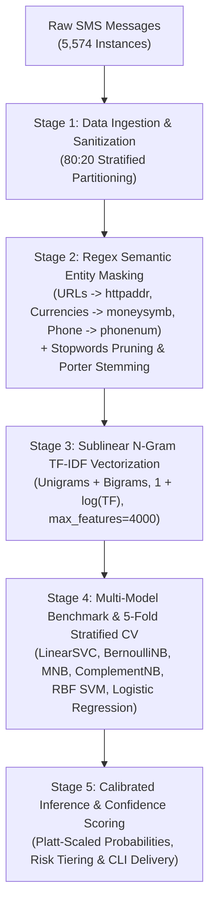

# SMS Spam Message Detection Using Naive Bayes & Support Vector Machines

[](https://www.python.org/)
[](https://opensource.org/licenses/MIT)
[](https://scikit-learn.org/)
[](https://www.nltk.org/)
[](docs/IEEE_Conference_Paper_SMS_Spam_Detection.pdf)
[](docs/SMS_Spam_Message_Detection_Presentation.pptx)

A complete, clean, and reproducible Machine Learning and Natural Language Processing (NLP) repository for real-time Short Message Service (SMS) spam and smishing detection. Based on our research paper and presentation submitted at the Department of Computer Science and Engineering, Unitedworld Institute of Technology (UIT), Karnavati University.

---

## Authors & Affiliation

- **Ayush Panchal** (Student KUID: `KU2507U0431`)
- **Jaydeep Joshi** (Student KUID: `KU2507U0055`)
- **Manav Sharma** (Student KUID: `KU2507U0024`)

*Department of Computer Science and Engineering (Cyber Security)*  
*Unitedworld Institute of Technology (UIT), Karnavati University, Gandhinagar, Gujarat, India*

---

## Documentation & Primary References

- 📄 **Research Paper (PDF)**: [`docs/IEEE_Conference_Paper_SMS_Spam_Detection.pdf`](docs/IEEE_Conference_Paper_SMS_Spam_Detection.pdf)
- 📊 **Conference Presentation Deck (PPTX)**: [`docs/SMS_Spam_Message_Detection_Presentation.pptx`](docs/SMS_Spam_Message_Detection_Presentation.pptx)
- 📝 **Paper Source (DOCX)**: [`docs/IEEE_Conference_Paper_SMS_Spam_Detection_Edited.docx`](docs/IEEE_Conference_Paper_SMS_Spam_Detection_Edited.docx)

---

## Problem Overview

With over 5 billion global mobile subscribers and an open rate exceeding **98%** (with ~90% opened within 3 minutes), Short Message Service (SMS) represents the most direct digital communication medium. However, this immediacy makes mobile networks a prime target for malicious actors engaging in:
- **Smishing (SMS Phishing)**: Impersonating financial institutions to steal banking credentials.
- **Advance-Fee & Lottery Scams**: Falsely claiming monetary awards to extract fees.
- **Malware Propagation**: Distributing dangerous zero-click or credential-harvesting hyperlinks.

### Why SMS Spam Detection is Unique & Challenging

1. **Lack of Network Metadata**: Unlike desktop email with headers, SPF, DKIM, and reverse DNS records, SMS payloads arrive bare at client handsets without routing metadata.
2. **Extreme Linguistic Conciseness & Noise**: Bounded by 160 characters, users and spammers compress language using phonetic slang (`"u"`, `"dun"`), abbreviations, and intentional character obfuscation (`"FR€€"`, `"W!NNER"`).
3. **The Asymmetric Cost of False Positives**: In email, a misclassified genuine email (false positive) rests safely in a junk folder. In mobile SMS, an erroneously blocked message causes missed time-sensitive **two-factor authentication (2FA) OTPs**, banking fraud alerts, flight gate updates, or medical emergencies. Therefore, **Specificity must approach 100.0%**.
4. **Lightweight Edge Inference vs. Heavy Transformers**: While Large Language Models (BERT, RoBERTa) achieve high accuracy on standard corpora, their 400MB+ parameter footprint causes excessive battery drain and inference latency (~150–400 ms) on edge mobile processors. In contrast, **Linear Support Vector Machines (LinearSVC)** and **Naive Bayes (Multinomial & Bernoulli)** deliver **sub-millisecond (<2 ms) inference** with negligible RAM footprint while achieving **98.9%+ accuracy**.

---

## 5-Stage System Architecture



### Stage Details

1. **Stage 1: Data Ingestion & Sanitization**  
   Ingests the canonical SMS Spam Collection dataset (5,574 labeled messages: 4,827 ham / 86.60% and 747 spam / 13.40%). Partitions into an **80:20 stratified split** (4,459 train / 1,115 test) to preserve identical 6.46:1 class distribution without data leakage.

2. **Stage 2: Regular-Expression Semantic Entity Masking & Porter Stemming**  
   Standard text normalization discards punctuation and digits. In smishing, however, currencies, hyperlinks, and contact sequences carry the primary malicious intent. We mask raw patterns to unified semantic tokens:
   - **URLs**: `https?://\S+|www\.\S+` &rarr; `httpaddr`
   - **Email Addresses**: `\b[A-Za-z0-9._%+-]+@[A-Za-z0-9.-]+\.[A-Za-z]{2,}\b` &rarr; `emailaddr`
   - **Currencies**: `[£$€₹¥]` or currency codes &rarr; `moneysymb`
   - **Phone Sequences**: `\b(?:\+?\d{1,4}[-.\s]?)?(?:\(?\d{2,5}\)?[-.\s]?)?\d{3,5}[-.\s]?\d{3,5}\b|\b\d{5,}\b` &rarr; `phonenum`
   - **Numeric Quantities**: `\b\d+\b` &rarr; `numbr`  
   Text is subsequently lowercased, stripped of extraneous punctuation, filtered of uninformative English stopwords (198 terms), and reduced via **Porter Morphological Stemming** (`"congratulations"` &rarr; `"congratul"`).

3. **Stage 3: Sublinear N-Gram TF-IDF Vectorization**  
   Extracts both unigrams and bigrams (`ngram_range=(1, 2)`) to capture multi-word scam motifs (e.g., `"free entry"`, `"cash prize"`, `"call now"`). Sublinear term frequency scaling (`1 + log(TF)`) prevents spammed repetition within a single message from distorting the feature space. Feature dictionary is capped at **4,000 maximum vocabulary features**.

4. **Stage 4: Multi-Model Benchmarking & 5-Fold Stratified Cross-Validation**  
   Trains and evaluates six machine learning algorithms under identical conditions with 5-fold stratified cross-validation on the training set:
   - **Linear Support Vector Machine (LinearSVC)**: Maximum-margin soft hyperplane with coordinate descent via LIBLINEAR.
   - **Bernoulli Naive Bayes (BernoulliNB)**: Multivariate Bernoulli model evaluating binary feature presence.
   - **Support Vector Machine with RBF Kernel (SVC RBF)**: Non-linear kernel mapping $K(x, x') = \exp(-\gamma ||x - x'||^2)$.
   - **Multinomial Naive Bayes (MultinomialNB)**: Multinomial distribution with Laplace smoothing ($\alpha = 0.2$).
   - **Logistic Regression (LogReg)**: L2-regularized logistic sigmoid classification.
   - **Complement Naive Bayes (ComplementNB)**: Estimates parameters from the complement of each class to counter imbalance.

5. **Stage 5: Calibrated Inference & Confidence Scoring**  
   The primary production classifier (Linear SVM) is calibrated via Platt scaling (`CalibratedClassifierCV`) to output smooth, mathematically grounded prediction probabilities alongside margin scores.

---

## Experimental Evaluation & Benchmark Results

### Table I: Comparative Performance Across Machine Learning Classifiers (Independent Test Partition, N = 1,115)

| Classifier Architecture | Test Accuracy | Precision (Spam) | Recall (Spam) | F1-Score | Specificity (Ham) | ROC-AUC |
|:------------------------|:-------------:|:----------------:|:-------------:|:--------:|:-----------------:|:-------:|
| **Linear SVM (LinearSVC)** | **99.28%** | **99.30%** | **95.30%** | **97.26%** | **99.90%** | **0.9965** |
| **Bernoulli Naive Bayes** | **99.10%** | **100.00%** | **93.29%** | **96.53%** | **100.00%** | **0.9935** |
| **SVM (RBF Kernel)** | 98.92% | 99.28% | 92.62% | 95.83% | 99.90% | 0.9946 |
| **Multinomial Naive Bayes** | 98.65% | 98.55% | 91.28% | 94.77% | 99.79% | 0.9918 |
| **Logistic Regression** | 98.21% | 99.24% | 87.25% | 92.86% | 99.90% | 0.9943 |
| **Complement Naive Bayes** | 97.31% | 84.80% | **97.32%** | 90.62% | 97.31% | 0.9918 |

### Table II: Confusion Matrix Metric Counts (Test Partition, N = 1,115)

| Classifier Architecture | True Negative (Ham) | False Positive (FP) | False Negative (FN) | True Positive (Spam) |
|:------------------------|:-------------------:|:-------------------:|:-------------------:|:--------------------:|
| **Linear SVM (LinearSVC)** | **965** | **1** | **7** | **142** |
| **Bernoulli Naive Bayes** | **966** | **0** | **10** | **139** |
| **SVM (RBF Kernel)** | 965 | 1 | 11 | 138 |
| **Multinomial Naive Bayes** | 964 | 2 | 13 | 136 |
| **Logistic Regression** | 965 | 1 | 19 | 130 |
| **Complement Naive Bayes** | 940 | 26 | 4 | 145 |

### Key Empirical Findings

1. **Linear SVM is the Top Overall Performer**: Achieves the highest F1-score (**97.26%**), highest accuracy (**99.28%**), and highest ROC-AUC (**0.9965**), producing only **1 False Positive** out of 966 legitimate test messages (99.90% Specificity).
2. **Bernoulli Naive Bayes Achieves Zero False Positives**: Correctly classified all 966 legitimate messages with **100.0% Precision** and **100.0% Specificity** (0 False Alarms) while still capturing 93.29% of spam broadcasts.
3. **Multinomial Naive Bayes Offers Ideal Edge Economics**: Requires under 2 ms execution time per batch with 98.65% accuracy and only 2 False Positives.
4. **Complement Naive Bayes vs. Class Imbalance**: While CNB maximized recall (capturing 145 out of 149 spam messages / 97.32%), it inflated False Positives to 26 (84.80% precision). For operational telecom systems where blocking genuine OTPs is unacceptable, Linear SVM and Bernoulli/Multinomial Naive Bayes represent the preferred production choices.

---

## Repository Structure

```
iml-project/
├── .gitignore                      # Standard Python / ML ignore patterns
├── README.md                       # Comprehensive project documentation
├── requirements.txt                # Pinned production dependencies
├── data/
│   ├── README.md                   # Dataset documentation & provenance
│   └── spam.csv                    # Canonical SMS Spam Collection (5,574 instances)
├── docs/
│   ├── IEEE_Conference_Paper_SMS_Spam_Detection.pdf   # Research paper (IEEE layout)
│   ├── SMS_Spam_Message_Detection_Presentation.pptx   # Conference presentation deck
│   └── IEEE_Conference_Paper_SMS_Spam_Detection_Edited.docx # Paper document source
├── artifacts/                      # Serialized models & metadata (generated by train.py)
│   ├── best_model.joblib           # Calibrated Linear SVM classifier
│   ├── tfidf_vectorizer.joblib     # Fitted sublinear n-gram TF-IDF vectorizer
│   ├── linear_svc_raw.joblib       # Uncalibrated LinearSVC model
│   ├── multinomial_nb.joblib       # Trained Multinomial Naive Bayes model
│   └── model_metadata.json         # Evaluation metrics and pipeline configuration
└── src/
    ├── __init__.py                 # Module exports and package initialization
    ├── preprocess.py               # Regex entity masking, normalization & stemming
    ├── train.py                    # Training pipeline, 5-fold CV & artifact generation
    └── predict.py                  # Real-time CLI inference & interactive testing
```

---

## Setup & Installation

### 1. Prerequisites

- Python 3.10, 3.11, 3.12, or 3.14
- Git

### 2. Clone Repository & Setup Virtual Environment

```bash
# Clone the repository
git clone https://github.com/your-username/sms-spam-detection.git
cd sms-spam-detection

# Create a virtual environment
python -m venv venv

# Activate virtual environment
# On Linux/macOS:
source venv/bin/activate
# On Windows (PowerShell):
.\venv\Scripts\Activate.ps1
# On Windows (Command Prompt):
.\venv\Scripts\activate.bat
```

### 3. Install Dependencies

```bash
pip install -r requirements.txt
```

*(Optional: NLTK stopwords data is included with an automatic offline fallback in `src/preprocess.py`. If you wish to explicitly cache NLTK data globally, run `python -c "import nltk; nltk.download('stopwords')"`).*

---

## CLI Usage Examples

### 1. Execute Model Training & Benchmarking Pipeline

Trains all 6 classifiers, executes 5-fold stratified cross-validation, prints Tables I & II, and serializes artifacts to `artifacts/`:

```bash
python src/train.py
```

*Note: If `data/spam.csv` is not present, `src/train.py` automatically downloads it from the UCI Machine Learning Repository or falls back gracefully to a synthetic local set.*

---

### 2. Real-Time SMS Message Classification

Pass any message directly as a command-line string:

#### Example A: Smishing / Prize Scam Detection
```bash
python src/predict.py "Claim your £1000 prize now! Call 08000930705 or visit http://win-prizes.com"
```
**Output:**
```
======================================================================
 SMS CLASSIFICATION RESULT:  [ SPAM ]   [!!! SPAM / SMISHING DETECTED !!!]
======================================================================
  Input SMS         : "Claim your £1000 prize now! Call 08000930705 or visit http://win-prizes.com"
  Normalized Tokens : claim moneysymb numbr prize call phonenum visit httpaddr
  Detected Entities : Hyperlink / URL (httpaddr), Financial Currency (moneysymb), Phone Sequence (phonenum), Numeric Quantities (numbr)
----------------------------------------------------------------------
  Classification    : SPAM
  Confidence Score  : 100.00%
  Spam Probability  : 100.00%
  Assessed Risk     : CRITICAL (High Smishing Threat)
======================================================================
```

#### Example B: Legitimate Conversational Message
```bash
python src/predict.py "Hey, are we still meeting for lunch today at 1?"
```
**Output:**
```
======================================================================
 SMS CLASSIFICATION RESULT:  [ HAM ]   [✓ LEGITIMATE MESSAGE (HAM)]
======================================================================
  Input SMS         : "Hey, are we still meeting for lunch today at 1?"
  Normalized Tokens : hey still meet lunch today numbr
  Detected Entities : Numeric Quantities (numbr)
----------------------------------------------------------------------
  Classification    : HAM
  Confidence Score  : 99.92%
  Spam Probability  : 0.08%
  Assessed Risk     : SAFE (Legitimate Transactional / Personal)
======================================================================
```

---

### 3. Interactive REPL Mode

Test multiple arbitrary messages interactively without reloading the model:

```bash
python src/predict.py --interactive
```

---

### 4. Batch Message Prediction from File

Evaluate an entire list of SMS text messages (one message per line):

```bash
python src/predict.py --file path/to/messages.txt
```

---

### 5. Programmatic JSON Output

Integrate directly into REST APIs or microservice pipelines:

```bash
python src/predict.py "URGENT: Your account has been suspended. Call 08712400603" --json
```
**JSON Response:**
```json
{
  "raw_message": "URGENT: Your account has been suspended. Call 08712400603",
  "masked_message": "URGENT: Your account has been suspended. Call  phonenum",
  "cleaned_tokens": "urgent account suspend call phonenum",
  "label": "SPAM",
  "is_spam": true,
  "confidence": 0.9984,
  "spam_probability": 0.9984,
  "risk_tier": "CRITICAL (High Smishing Threat)",
  "detected_entities": [
    "Phone Sequence (phonenum)"
  ]
}
```

---

### 6. Selecting Model Architecture

Compare inference between the calibrated Linear SVM and Multinomial Naive Bayes:

```bash
# Calibrated Linear SVM (Default)
python src/predict.py "Your message here" --model best

# Raw LinearSVC
python src/predict.py "Your message here" --model linear_svc

# Multinomial Naive Bayes
python src/predict.py "Your message here" --model multinomial_nb
```

---

## Academic Citation

If you use this repository, the preprocessed entity masking pipeline, or the benchmark results in your research or project, please cite:

```bibtex
@inproceedings{panchal2026sms,
  title={SMS Spam Message Detection Using Multinomial Naive Bayes and Support Vector Machine Classifiers: A Comparative Study},
  author={Panchal, Ayush and Joshi, Jaydeep and Sharma, Manav},
  booktitle={Machine Learning Mini Project Proceedings},
  organization={Department of Computer Science and Engineering, Unitedworld Institute of Technology (UIT), Karnavati University},
  address={Gandhinagar, Gujarat, India},
  year={2026}
}
```

---

## License

This project is licensed under the [MIT License](LICENSE).
